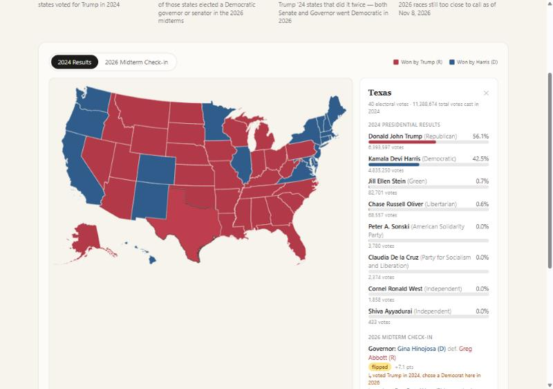
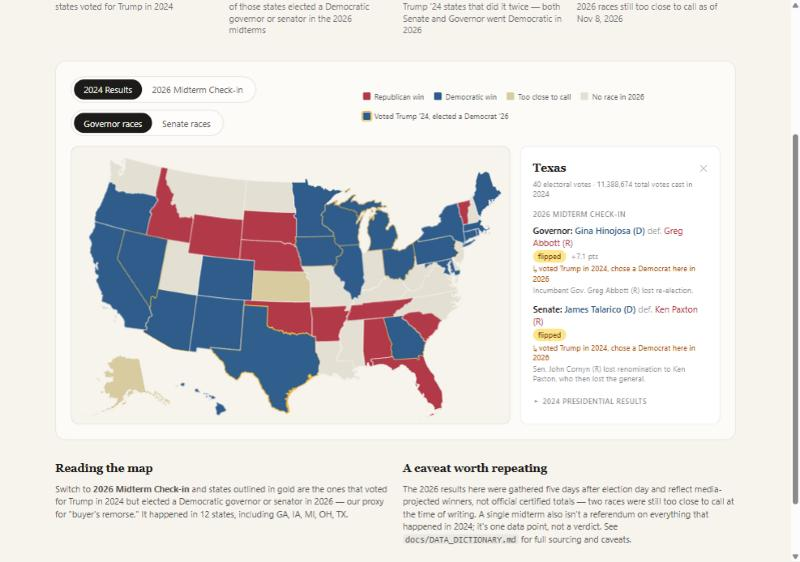
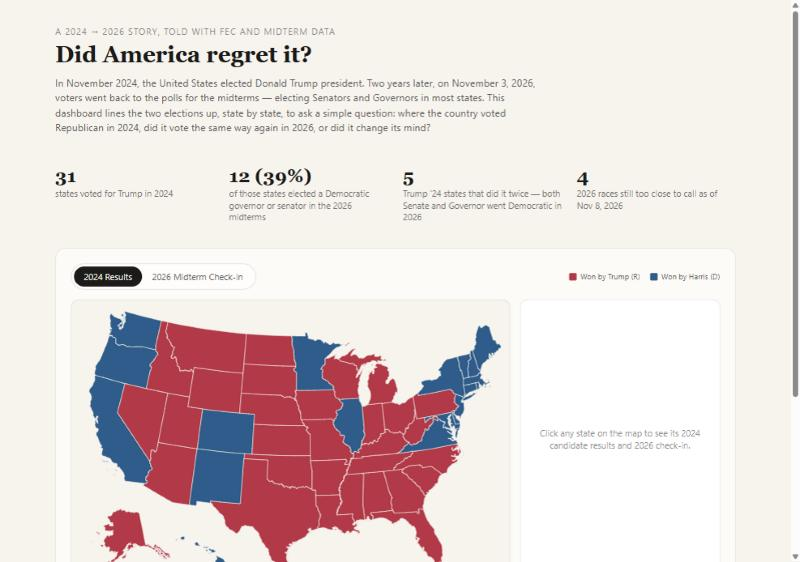

# Did America Regret It?

An interactive dashboard exploring the 2024 US presidential election results
and lining them up, state by state, against the 2026 midterm elections, built
in JavaScript (React + D3 + TopoJSON) instead of Python or R.

**Live question:** where the country voted Republican in 2024, did it vote the
same way again in the 2026 midterms, or did it change its mind?

| 2024 results, state detail | 2026 midterm check-in |
|---|---|
|  |  |



## What it does

- A US choropleth map (D3 + `us-atlas` TopoJSON, Albers USA projection) that
  toggles between two modes:
  1. **2024 Results** — every state colored by which candidate won its
     popular vote.
  2. **2026 Midterm Check-in** — every state colored by its 2026 Governor or
     Senate race result, with states outlined in gold where a state that
     voted for Trump in 2024 elected a Democrat in 2026 (this project's
     documented "regret signal").
- Click (or hover) any state to open a detail panel with:
  - The full breakdown of **every 2024 presidential candidate** on that
    state's ballot (not just the top two), with vote share, vote count and
    party.
  - Each candidate's **info** (full name, running mate, party) resolved from
    a hand-built candidate dictionary, since the source workbook only lists
    surnames.
  - That state's 2026 Governor and Senate results, including flip status,
    margin, and the "voted Trump in 2024, chose a Democrat here in 2026"
    annotation when it applies.
- An insights strip with headline, computed statistics (e.g. how many 2024
  Trump states elected a Democrat in 2026) and narrative copy with explicit
  caveats about data freshness and certification status.

See [`docs/DATA_DICTIONARY.md`](docs/DATA_DICTIONARY.md) for exactly where
every field comes from, how it was cleaned, and the known limitations of the
2026 layer (gathered 5 days after election day, not yet officially certified).

## Running it locally

Requires [Node.js](https://nodejs.org/) 18+.

```bash
npm install
npm run dev
```

Then open the URL Vite prints (typically `http://localhost:5173`). That's it
— `npm run dev` automatically rebuilds the cleaned datasets from the raw
sources in `data/raw/` before starting the dev server (see
`scripts/build-data.mjs`), so there's nothing else to set up.

To produce a static production build:

```bash
npm run build
npm run preview
```

## Project structure

```
data/
  raw/                  # Source data: the FEC workbook + hand-compiled
                         # dictionaries/2026 results, each documented inline
  processed/            # Generated, cleaned JSON (never edit by hand --
                         # run `npm run build-data` to regenerate)
docs/
  DATA_DICTIONARY.md    # Field-by-field documentation and data governance notes
scripts/
  build-data.mjs        # Parses the FEC workbook, merges in the 2026 layer
src/
  components/           # USMap, Controls, Legend, StatePanel, InsightsStrip
  lib/                  # Data lookups (lib/data.js) and derived stats (lib/insights.js)
  App.jsx               # Page layout / narrative structure
```

## Data sources

- U.S. Federal Election Commission, *"2024 Official Presidential General
  Election Results"* (`data/raw/2024presgeresults.xlsx`), published
  2025-01-16 — the certified federal record of the 2024 presidential race.
- The Green Papers, 2024 presidential candidate list — used to resolve
  candidate surnames to full names, running mates and parties.
- Wikipedia, *"2026 United States Senate elections"* and *"2026 United States
  gubernatorial elections"*, accessed 2026-11-08 — media-projected 2026
  midterm results, **not yet officially certified** at the time of writing.
  Full caveats in the data dictionary.

## Tech stack

Vite + React 18 for the app shell, D3 (`d3-geo`) + `topojson-client` +
`us-atlas` for the map geometry and projection, Tailwind CSS for styling, and
the `xlsx` (SheetJS) package in the build script only, to parse the original
FEC workbook into clean JSON at build time.
